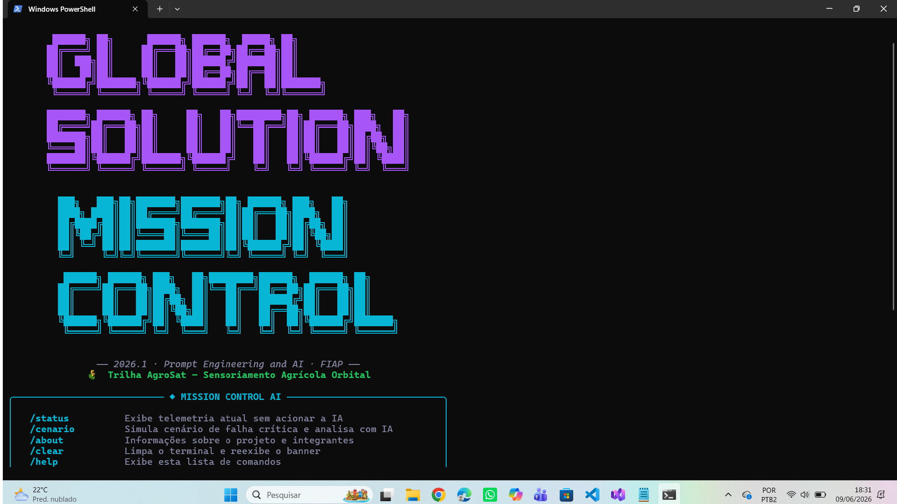
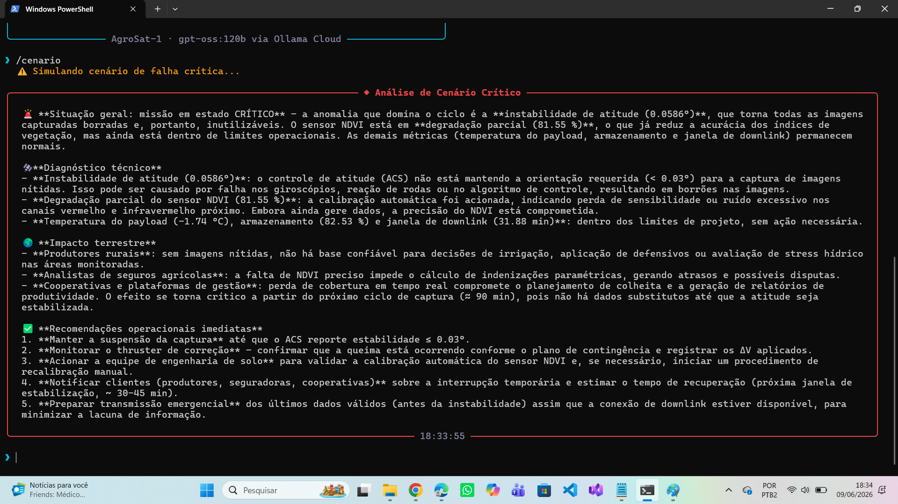

# 🚀 Mission Control AI — AgroSat

> Sistema inteligente de monitoramento de satélite de sensoriamento agrícola com análise por IA generativa.

---

## 👥 Integrantes

| Nome Completo | RM | Turma |
|---|---|---|
| [Nome Integrante 1] | RM: XXXXXX | XCCXX |
| [Nome Integrante 2] | RM: XXXXXX | XCCXX |

**Modalidade:** Dupla  
**Disciplina:** Prompt Engineering and Artificial Intelligence · FIAP · Ciência da Computação  
**Trilha:** 🌾 AgroSat — Sensoriamento Agrícola

---

## 📌 O que o projeto faz

O **Mission Control AI — AgroSat** é uma CLI (interface de linha de comando) que simula o monitoramento operacional de um satélite de sensoriamento multiespectral em órbita baixa. O sistema coleta dados de telemetria simulados (saúde do sensor NDVI, temperatura do payload, armazenamento, janela de downlink e estabilidade de atitude), aplica lógica de alertas em Python e usa o modelo **gpt-oss:120b via Ollama Cloud** para analisar o estado da missão em linguagem natural — sempre conectando cada anomalia técnica ao impacto concreto no agronegócio brasileiro.

A IA não decide se algo é crítico ou não — essa lógica está no código Python. A IA **explica**, **contextualiza** e **traduz** o dado técnico para o operador e para o produtor rural que depende das imagens do satélite.

---

## 🎭 Persona atendida

**Operador do centro de controle do AgroSat-1** — engenheiro de operações de solo responsável por monitorar a saúde do satélite em tempo real e garantir que os dados de sensoriamento cheguem às plataformas agrícolas (Climate FieldView, Embrapa Monitora, cooperativas) sem interrupção.

O sistema também produz análises acessíveis para **analistas de seguro agrícola** e **gestores de cooperativas** que precisam entender, em linguagem simples, quando e por que os dados de NDVI podem estar comprometidos.

---

## 🛠 Tecnologias utilizadas

- **Python 3.10+**
- **Ollama Cloud API** — modelo `gpt-oss:120b`
- **Rich 15.0.0** — interface de terminal com painéis, tabelas e cores
- **prompt-toolkit 3.0.52** — input editável com histórico de comandos
- **PyFiglet 1.0.4** — banner ASCII art
- **python-dotenv 1.2.2** — gerenciamento seguro de credenciais

---

## ⚙️ Como executar

### 1. Clone o repositório

```bash
git clone https://github.com/usuario/mission-control-ai.git
cd mission-control-ai
```

### 2. Crie e ative o ambiente virtual

```bash
python -m venv .venv
# Linux/Mac:
source .venv/bin/activate
# Windows:
.venv\Scripts\activate
```

### 3. Instale as dependências

```bash
pip install -r requirements.txt
```

### 4. Configure as credenciais

Crie o arquivo `.env` na raiz do projeto (use `.env.example` como base):

```bash
cp .env.example .env
```

Edite o `.env` e insira sua chave da Ollama Cloud:

```
OLLAMA_API_KEY=sua_chave_aqui_sem_aspas
```

> Obtenha sua chave gratuitamente em [ollama.com](https://ollama.com) → Settings → API Keys

### 5. Execute o sistema

```bash
python main.py
```

---

## 🖥 Demonstração

### Banner e tela inicial


### IA analisando cenário de alerta


---

## 🤖 System Prompt

O system prompt completo está em [`prompts/system_prompt.md`](prompts/system_prompt.md).

Destaques da engenharia de prompt aplicada:
- **Identidade e papel** definidos com precisão (operador de solo, não assistente genérico)
- **Few-shot prompting** com dois exemplos completos (situação normal e crítica)
- **Estrutura obrigatória** de resposta (diagnóstico técnico → criticidade → impacto terrestre → recomendação)
- **Glossário de calibração** para manter tom técnico-acessível
- **Restrições explícitas** para evitar alucinações e respostas fora de escopo

---

## 🧪 Cenários de teste demonstrados

| # | Cenário | Parâmetros em alerta | Nível |
|---|---|---|---|
| 1 | Operação normal | Nenhum | 🟢 NORMAL |
| 2 | Temperatura elevada do payload | Temperatura > 55°C | 🟡 ATENÇÃO |
| 3 | Armazenamento crítico + downlink curto | Storage < 10% + Downlink < 5min | 🔴 CRÍTICO |
| 4 | Falha múltipla (SEU simulado) | NDVI + Temp + Storage + Atitude | 🔴 CRÍTICO |
| 5 | Degradação gradual do sensor NDVI | NDVI < 65% | 🟡 ATENÇÃO |

Use `/cenario` na CLI para simular o cenário de falha crítica interativamente.

---

## 💼 Proposta de valor / modelo de negócio

### 1. Qual o problema real terrestre que esta missão resolve?

O agronegócio brasileiro movimenta mais de R$ 2 trilhões por ano, mas a maioria das decisões operacionais (quando irrigar, quando colher, como precificar seguro rural) ainda depende de dados de campo coletados manualmente — lentos, caros e imprecisos. O AgroSat-1 resolve o gap de informação: entrega índices de vegetação (NDVI) atualizados por ciclo orbital (~90 minutos) para milhares de produtores que não têm acesso a sensoriamento de campo adequado.

### 2. Quem paga pela solução?

**Modelo híbrido:**
- **Setor privado** (principal): operadoras de seguros agrícolas (Mapfre, Allianz Rural, BB Seguridade) pagam por acesso à API de NDVI para calibrar apólices paramétricos. Cooperativas (Coamo, Cocamar) pagam assinatura para integração com sistemas de gestão de safra.
- **Setor público** (complementar): MAPA e INPE financiam parte da infraestrutura como contrapartida de acesso a dados históricos para políticas públicas agrícolas.

### 3. Métrica de impacto (1 ano de operação saudável)

Se o AgroSat-1 operar 100% saudável por 1 ano:
- **~400 mil hectares monitorados** por ciclo orbital (estimativa baseada na cobertura do CBERS-4A)
- **~120 cooperativas** com acesso a alertas de saúde de lavoura em tempo quase real
- **~15 mil produtores rurais** recebendo recomendações de irrigação baseadas em NDVI
- Redução estimada de **8–12% no uso de água para irrigação** por decisões mais precisas
- Base de dados para cobertura de seguros de **~R$ 850 milhões em lavouras monitoradas**

### 4. Modelo de negócio

**Dado-como-serviço (DaaS) + SaaS:**
- Camada 1 (DaaS): venda de acesso à API de imagens e índices processados — por hectare/mês ou por assinatura de área.
- Camada 2 (SaaS): plataforma web com dashboard de alertas para gestores de cooperativa e analistas de seguro — assinatura mensal por usuário.
- Camada 3 (Dados históricos): licenciamento de séries temporais para pesquisa agrícola (Embrapa, universidades) e modelagem climática.

---

## ⚠️ Limitações conhecidas

- Os dados de telemetria são **simulados aleatoriamente** — não representam dados reais de nenhum satélite em operação.
- A análise da IA pode **variar entre execuções** para os mesmos dados de entrada (non-determinismo do LLM). Recomenda-se testar o mesmo cenário 2–3 vezes para validar consistência.
- O sistema **não mantém histórico entre sessões** — ao reiniciar `main.py`, a memória de contexto é zerada.
- A integração com Ollama Cloud **depende de conexão com a internet** — não funciona offline.
- Os parâmetros simulados foram calibrados para plausibilidade operacional, mas **não refletem especificações reais** do CBERS-4A ou de satélites da Planet Labs.

---

## 🎬 Vídeo de demonstração

🔗 [Assistir demonstração no YouTube](https://www.youtube.com/watch?v=SEU_ID_AQUI)

> Configurado como "Não listado" no YouTube. Duração: ~3 minutos.

---

## 📁 Estrutura do projeto

```
mission-control-ai/
├── README.md
├── main.py
├── banner_ascii.py
├── requirements.txt
├── .env.example
├── .gitignore
├── src/
│   ├── __init__.py
│   ├── ui.py          ← Interface CLI (Rich + prompt-toolkit)
│   ├── engine.py      ← Motor de análise + integração Ollama
│   ├── telemetria.py  ← Geração de dados simulados
│   └── alertas.py     ← Thresholds e lógica de decisão Python
├── prompts/
│   └── system_prompt.md
├── data/
│   └── cenarios.json
└── assets/
    ├── screenshot_banner.png
    └── screenshot_analise.png
```
